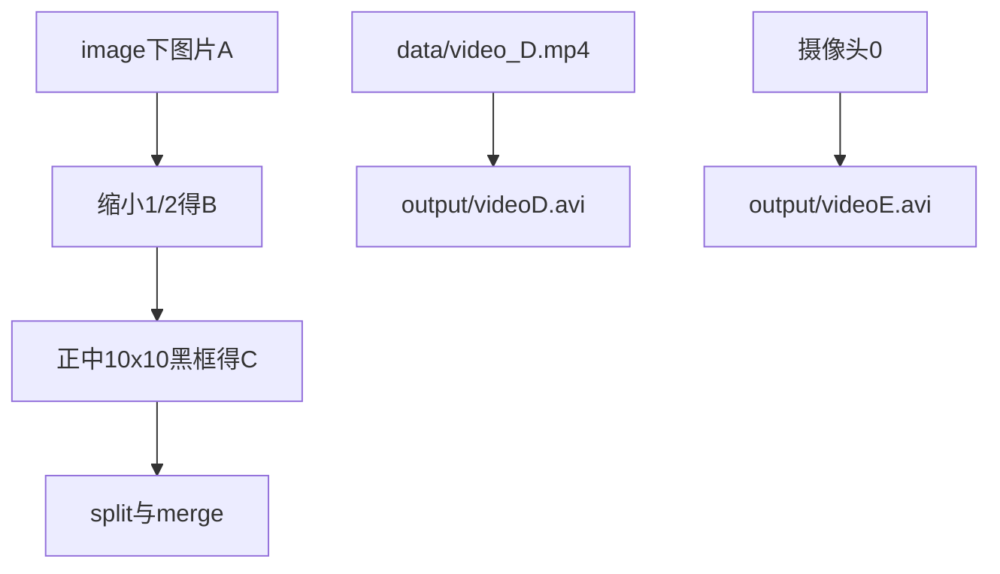

# 实验一 · 入门精讲文档索引

对照 [`lab1/`](../) 下的脚本学习 OpenCV 图像/视频基础。题目与验收标准见 [`作业要求/实验一-OpenCV图像处理基础-要求.md`](../../作业要求/实验一-OpenCV图像处理基础-要求.md)；本目录侧重「库、API、Python 基础、代码怎么读」。

## 推荐学习顺序

| 顺序 | 文档 | 对应脚本 | 学什么 |
|------|------|----------|--------|
| 1 | [01_install_check.md](01_install_check.md) | `01_install_check.py` | 安装、导入、版本 |
| 2 | [00_demo.md](00_demo.md) | `00_demo.py` | 读图弹窗（环境冒烟） |
| 3 | [02_03_image_basic.md](02_03_image_basic.md) | `02_03_image_basic.py` | 读图、缩小、数组属性 |
| 4 | [04_05_draw_and_show.md](04_05_draw_and_show.md) | `04_05_draw_and_show.py` | 画矩形、Esc/q |
| 5 | [06_07_channels.md](06_07_channels.md) | `06_07_channels.py` | split / merge、BGR |
| 6 | [08_canvas.md](08_canvas.md) | `08_canvas.py` | NumPy 创建画布 |
| 7 | [09_video_play_save.md](09_video_play_save.md) | `09_video_play_save.py` | 播视频、写 AVI |
| 8 | [10_camera_save.md](10_camera_save.md) | `10_camera_save.py` | 摄像头录制 |

每份文档结构统一：**要做什么 → 库 → API → Python 基础 → 代码导读 → 运行观察 → 自测**。

## 目录结构（相对 `test1/`）

```text
test1/
├── image/          # 图片 A（如 R-C.jpg），脚本里写死绝对路径
├── data/           # 视频 D：video_D.mp4
├── output/         # 输出：videoD.avi、videoE.avi
├── lab1/           # 实验脚本 + docs/
└── 作业要求/       # 题目原文与报告模板
```

把你自己的彩色图放进 `image/`（默认脚本读 `R-C.jpg`）。视频放 `data/video_D.mp4`。若文件名或盘符不同，直接改各 `.py` 里的 `PATH_... = r"..."`。

## 运行环境

在 PowerShell 中先进入 `test1` 目录，再用你的 OpenCV 环境解释器运行，例如：

```powershell
cd D:\Project\Vision\test1
D:\SoftWare\anaconda\envs\opencv\python.exe lab1\01_install_check.py
```

请把路径改成你本机的 Anaconda/Python 路径。正确的包名是 **`opencv-python`**（不是 `openv-python`）。

## 路径约定（简化版）

各脚本用原始字符串写绝对路径，例如：

```python
PATH_A = r"D:\Project\Vision\test1\image\R-C.jpg"
```

不再使用 `common_paths` 或环境变量。换图 / 换机器时，改对应脚本中的路径即可。

## 数据依赖简图


