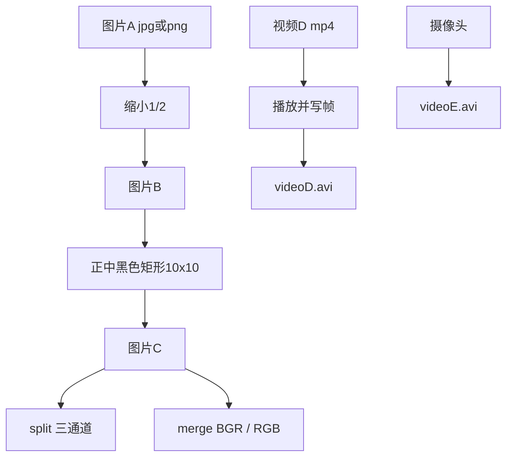
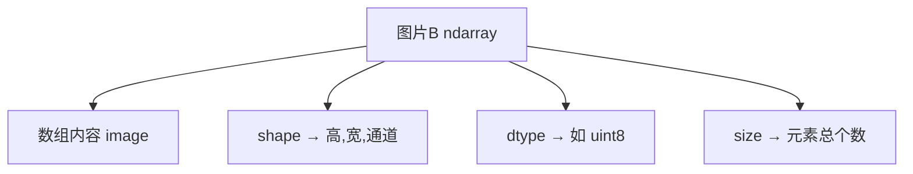
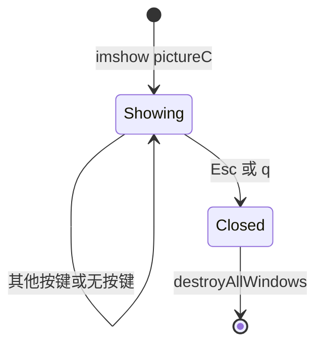
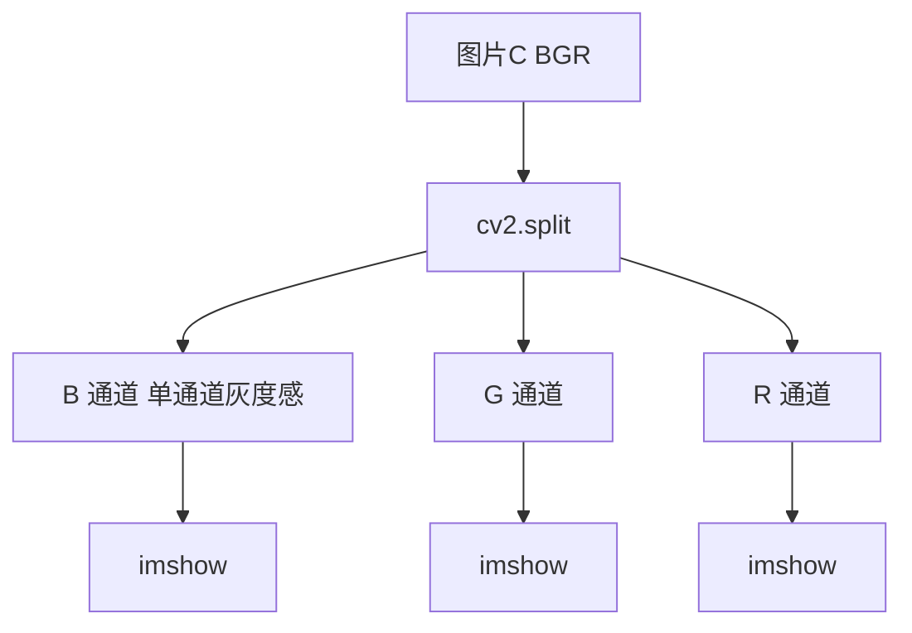
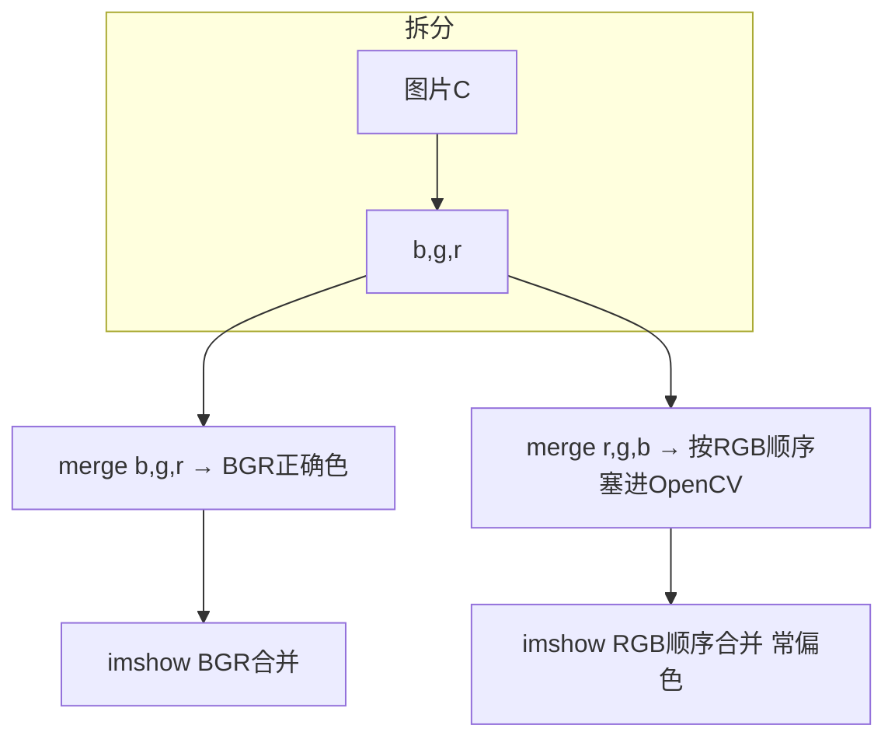
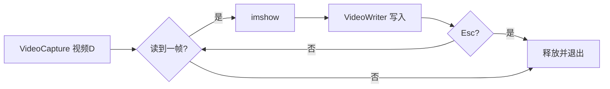

# 实验一 OpenCV 图像处理基础（要求与图解）

> 课程：计算机视觉｜学院：工学院  
> 本文由作业原文整理；包名原文写作 `openv-python`，正确包名为 **`opencv-python`**。

---

## 一、实验目的

自行安装 OpenCV，掌握图像读取、显示、保存等基础操作，熟悉 OpenCV 基本功能。

---

## 二、实验全流程总览


**数据依赖简图：**



---

## 三、实验内容（图文对照）

### 题 1：安装并查看版本

**要求：** 用命令安装 `opencv-python`，并查看已安装版本。


**你要验证：** 终端能打印出版本号（如 `4.x.x`），且无 `ModuleNotFoundError`。

---

### 题 2：读图、缩小、显示 5 秒

**要求：** 下载一张 jpg/png 彩色图记为 **图片 A**；用 OpenCV 读取；缩小为原来的 **1/2** 得到 **图片 B**；窗口展示 B，延迟 **5 秒**。


**要点：** OpenCV 彩色图默认是 **BGR** 通道顺序（不是 RGB）。

---

### 题 3：打印图片 B 的数组信息

**要求：** 打印图片 B 的数组、形状、数组元素数据类型、以及数组元素个数。



**示例含义（数值因图而异）：**

| 属性 | 含义 |
|------|------|
| `shape` | `(H, W, 3)` 高、宽、通道数 |
| `dtype` | 像素类型，常见 `uint8` |
| `size` | `H × W × 3` |

---

### 题 4：正中间画 10×10 黑色矩形 → 图片 C

**要求：** 在图片 B 正中间添加黑色矩形框，尺寸 **10×10**，得到 **图片 C**。

OpenCV 坐标系：**原点在左上角**，x 向右，y 向下；`rectangle` 填色用 BGR，黑色为 `(0,0,0)`。

```text
        x →
    ┌──────────────────┐
  y │                  │
  ↓ │      ┌────┐      │  ← 10×10 黑块
    │      │████│      │     中心对齐整图中心
    │      └────┘      │
    │                  │
    └──────────────────┘
         图片 B / C
```

**中心矩形左上角计算：**


---

### 题 5：显示 pictureC，Esc 或 q 退出

**要求：** 窗口展示图片 C，窗口名为 **`pictureC`**；按下 **Esc** 或 **q** 关闭，否则一直显示。



**要点：** 需要循环调用 `waitKey(1)`（或合适延时）读取键盘；Esc 的键码通常为 `27`。

---

### 题 6：拆分三通道并展示灰度图

**要求：** 将图片 C 的 3 个色彩通道拆分，并展示三个通道的灰度图。



**记忆：** `split` 得到的顺序是 **B, G, R**（与存储顺序一致）。

---

### 题 7：按 RGB、BGR 合并并展示

**要求：** 将图片 C 的 3 个色彩通道按照 **RGB、BGR** 进行合并，并分别展示。

> 原文写「分别展示三个通道的灰度图」；合并后的结果是彩色图。实践中应分别展示 **RGB 顺序合并图** 与 **BGR 顺序合并图**，对比色偏差异。



**对比直觉：** OpenCV 的 `imshow` 仍按 BGR 解释通道；把 R 放进第一个通道会看起来颜色错乱——这正是本题要体会的点。

---

### 题 8：320×320 黑色图 → 改像素 100 → 自动关窗

**要求：** 创建 **320×320** 黑色正方形图像，展示 **5 秒**；再把所有像素值改为 **100**，再展示 **5 秒** 后自动关闭窗口。


---

### 题 9：播放视频 D，保存为 videoD.avi

**要求：** 下载 **1 分钟以内** 视频 D（建议 mp4）；用 OpenCV 播放；按 **Esc** 退出；将视频逐帧保存到 **`videoD.avi`**；打印 **帧速率** 和 **视频尺寸**。



**同时打印：** `fps`、宽高（或 `shape`）。

---

### 题 10：捕获摄像头 → videoE.avi

**要求：** 捕获摄像头数据，并保存到 **`videoE.avi`**。


**注意：** 需本机摄像头权限；无摄像头时可说明环境限制并截图报错信息。

---

## 四、实验报告结构要求

### 1. 实验环境说明

| 序号 | 项目 | 具体描述 |
|------|------|----------|
| 1 | 系统环境 | Win10（或你的实际系统） |
| 2 | 软件环境 | Python、Cursor/IDE 等 |
| 3 | 依赖类库 | opencv-python 及版本号 |

### 2. 数据集说明

写明：图片 A / 视频 D 的来源、文件名、分辨率或时长等特点。

### 3. 实验过程

分步骤编写代码，并配上解释说明。

### 4. 实验结果

附截图，并做简要分析与评价。

---

## 五、关键 API 速查（与上图节点对应）

| API | 用途 |
|-----|------|
| `cv2.imread` | 读图 |
| `cv2.resize` | 缩放（题 2） |
| `cv2.imshow` / `cv2.waitKey` / `cv2.destroyAllWindows` | 显示与等待 |
| `img.shape` / `img.dtype` / `img.size` | 数组属性（题 3） |
| `cv2.rectangle` | 画矩形（题 4） |
| `cv2.split` / `cv2.merge` | 通道拆分合并（题 6–7） |
| `numpy.zeros` | 创建黑图（题 8） |
| `cv2.VideoCapture` | 读视频/摄像头（题 9–10） |
| `cv2.VideoWriter` | 写 avi（题 9–10） |

---

## 六、推荐实践目录（动手时使用）

```text
D:\Project\Vision\test1\
  data\
    image_A.jpg      ← 自备
    video_D.mp4      ← 自备，≤1 分钟
  lab1\
    01_install_check.py
    02_03_image_basic.py
    ...
  作业要求\
    实验一-OpenCV图像处理基础-要求.md   ← 本文件
```

运行环境建议使用：`py -3`。
